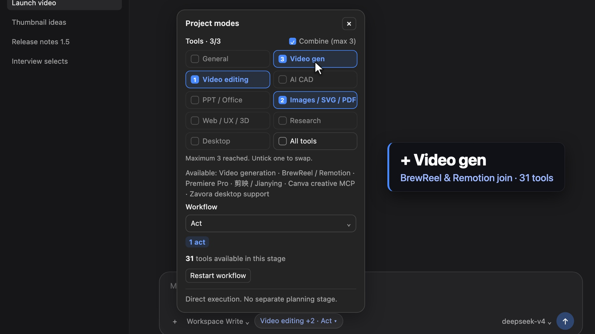

# DSH Project Modes — a toolset + workflow picker for DeepSeek Harness

_Version 1.5.0 · 49 tests_

A small plugin for [DeepSeek Harness (DSH)](https://www.npmjs.com/package/@deepseek-ai/dsh) web that adds a
compact **`General · Plan ▾`** button beside the prompt box. Open it to choose:

- **Toolset** — which tool families the agent may load: General, Video gen, Video editing, AI CAD,
  PPT / Office, Images / SVG / PDF, Web / UX / 3D, Research, Desktop, All tools.
- **Workflow** — Research → Plan → Act, Plan → Act (default), Act, or Research → Ask → Plan → Act.

Selections belong to the current chat, persist across restarts, and can change between responses.

### New in 1.5: combine up to 3 toolsets



By default the picker is single-choice: one toolset per chat, exactly as in 1.4. Tick **Combine (max 3)**
and the grid becomes multi-select:

- pick up to **three** toolsets (e.g. Video editing + Images / SVG / PDF + Video gen); the chat loads the
  **union** of their tools — 31 of 126 tools in that example instead of all 126;
- stage rules still apply to every member (Research / Ask / Plan stay read-only; Act unlocks changes);
- the chip shows the primary plus a count (`Video editing +2 · Act ▾`), and the ticks are numbered 1–3 in
  selection order; a fourth toolset is disabled until you untick one; **All tools** must be chosen alone;
- `project_tools` searches across every selected toolset; enabled extras survive a combo change only while
  they remain discoverable;
- the model's guidance lists every combined toolset and loads each one's specialist rules.

API: `POST /api/project-modes` accepts `projects: ["video-edit","image-docs","video"]` (1–3). The 1.4 field
`project` still works, and single choices still send it, so an older server keeps working with the new client.
State gains `projects` (with `project` = the primary); older saved states are read as single-toolset.

Demo video (46 s, real policy numbers): see the [v1.5.0 release](https://github.com/gank8818-bit/dsh-project-modes/releases/tag/v1.5.0).

## Why

Large MCP installs register hundreds of tools (one Premiere connector alone exposes 400+). Sending every
schema on every request wastes context and confuses the model. Project Modes:

- **masks the host tool registry** per session so only the chosen family's tools reach the model;
- adds a **guard** that blocks hidden tools even through nested dispatch;
- strips unrelated tool/MCP instructions from the assembled system prompt;
- gives the agent two tools: `project_stage` (record a plan estimate, advance exactly one stage with a
  revision check) and `project_tools` (search every installed tool without loading schemas, inspect up to
  3, enable up to 8 per request with a rolling cap of 12 extras, disable/clear);
- keeps **Research / Ask / Plan** stages read-only (shell for inspection only; desktop control limited to
  observation) and unlocks writes in **Act**.

Sandbox, approvals, authentication and desktop STOP policies are untouched — the plugin only narrows
what the model sees.

## Install (DSH 0.2.x web profile)

```sh
git clone https://github.com/gank8818-bit/dsh-project-modes ~/.dsh/plugins/dsh-project-modes
cd ~/.dsh/plugins/dsh-project-modes
ln -s "$(npm root -g)/@deepseek-ai/dsh/node_modules" node_modules   # reuse DSH's own dependencies
npm test && npm run build      # prints build-manifest.json with the versioned runtime path
```

Then link it into the web profile and point a loader entry at the built runtime:

```jsonc
// ~/.dsh/profiles/web/package.json → dependencies
"dsh-project-modes": "link:/ABSOLUTE/PATH/.dsh/plugins/dsh-project-modes"
```
```yaml
# ~/.dsh/profiles/web/cordis.patch.yml — add an insert entry whose `name` is the "runtime" path
# printed by `npm run build` (lib/<version>-<digest>/index.js). Restart `dsh web`, then refresh the page.
```

The build writes an immutable, content-addressed runtime under `lib/` so a profile reload never reuses
stale modules. Edit `client.source.js` (not the generated `client.js`).

State lives in `~/.dsh/project-modes/state.json`. Uninstall by removing the profile row and dependency.

## Files

| File | Role |
|---|---|
| `index.js` | host plugin: registry masks, guard, prompt assembly filter, `project_stage`, `project_tools`, `/api/project-modes` |
| `policy.js` | toolsets, workflows, stage rules, guidance text (pure functions, unit-tested) |
| `families.js` | tool-family routing by name pattern (Premiere, 剪映, Canva, CAD, …) |
| `client.source.js` | the React picker injected into `conversation.input.left` |
| `scripts/build.mjs` | validates the client and writes the versioned runtime |

## License

MIT. Not affiliated with DeepSeek.
